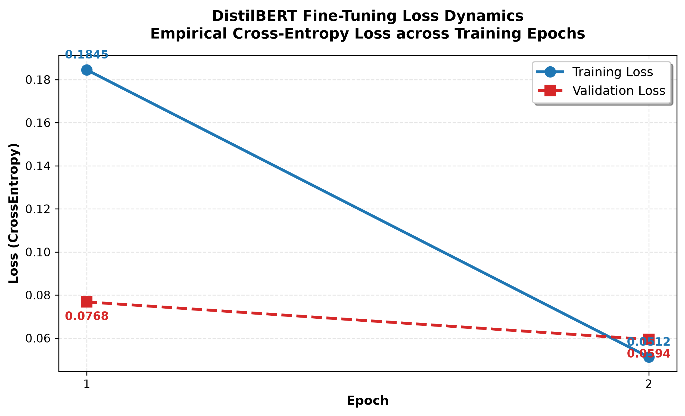

# Project 5 — Spam / Phishing Email Detection with Transformers
**Team 24** | Natural Language Processing & Deep Learning Capstone Project

An end-to-end Machine Learning and Natural Language Processing system for automated detection of unsolicited spam and deceptive phishing emails. The project benchmarks a fine-tuned **DistilBERT Transformer** against a classical **Multinomial Naive Bayes** baseline on the benchmark **Enron-Spam Corpus**, augmented with **LIME** (Local Interpretable Model-agnostic Explanations) for model transparency and an interactive **Streamlit** dashboard.

---

## 1. Problem Formulation and Dataset

### 1.1 Problem Statement
Email communication remains a primary vector for cybersecurity threats, ranging from commercial spam to sophisticated spear-phishing campaigns. Traditional heuristic filters and bag-of-words classifiers often struggle with adversarial vocabulary variations, semantic nuance, and context-dependent phrasing. This project investigates the efficacy of fine-tuning pre-trained contextual language models (DistilBERT) compared to classical statistical baselines (TF-IDF + Multinomial Naive Bayes), evaluating both predictive performance and model interpretability.

### 1.2 Enron-Spam Corpus
The empirical evaluation is conducted on the public **Enron-Spam dataset**, constructed from legitimate corporate correspondence and verified spam collections.
- **Total Valid Corpus**: 33,665 email documents (cleaned of degenerate and whitespace-only entries).
- **Label Distribution**: Balanced binary classification (Ham = 0: 16,545 samples [49.1%], Spam = 1: 17,120 samples [50.9%]).
- **Stratified Partitioning**:
  - **Training Split (80%)**: 26,932 samples (Ham: 13,236 | Spam: 13,696) &rarr; `data/train.csv`
  - **Validation Split (10%)**: 3,366 samples (Ham: 1,655 | Spam: 1,711) &rarr; `data/val.csv`
  - **Held-Out Test Split (10%)**: 3,367 samples (Ham: 1,654 | Spam: 1,713) &rarr; `data/test.csv`

---

## 2. Methodology & Architecture

### 2.1 Baseline Architecture: Multinomial Naive Bayes + TF-IDF
- **Vectorization**: Term Frequency-Inverse Document Frequency (`TfidfVectorizer`) extracting unigrams and bigrams (`ngram_range=(1, 2)`), limited to the top 10,000 informative features with English stop-word filtering.
- **Classification**: Multinomial Naive Bayes with Laplace smoothing (`alpha=1.0`), estimating posterior class probabilities via Bayes' theorem:
  $$P(C_k \mid \mathbf{x}) \propto P(C_k) \prod_{i=1}^n P(x_i \mid C_k)$$

### 2.2 Deep Transformer Architecture: DistilBERT
- **Backbone**: `distilbert-base-uncased` (6 transformer layers, 768 hidden dimensions, 12 attention heads, 66 million parameters).
- **Fine-Tuning Loop**: Built with native PyTorch `DataLoader` and `AutoModelForSequenceClassification`.
- **Optimization**: AdamW optimizer ($lr = 2 \times 10^{-5}$, weight decay $= 0.01$, gradient clipping norm $= 1.0$) with Cross-Entropy Loss over mini-batches ($B = 16$, max sequence length $= 256$ tokens).
- **Hardware Acceleration**: Automatic GPU CUDA detection with seamless CPU fallback.

### 2.3 Model Interpretability: LIME (Explainable AI)
- Local Interpretable Model-agnostic Explanations (**LIME**) approximates the local decision boundary around an input email by generating perturbed variations ($N = 250$ samples) and fitting a weighted sparse linear surrogate model:
  $$\xi(x) = \arg\min_{g \in G} \mathcal{L}(f, g, \pi_x) + \Omega(g)$$
- Extracts token-level attribution weights: positive coefficients push prediction toward **Spam**, whereas negative coefficients support **Ham / Legitimate**.

---

## 3. Repository Structure

```text
Spam-Phishing-Email-Detection-with-Transformers/
├── data/                               # Dataset directory (generated automatically)
│   ├── enron_spam_data.csv             # Raw Enron-Spam corpus
│   ├── train.csv                       # Stratified Training Split (80% - 26,932 samples)
│   ├── val.csv                         # Stratified Validation Split (10% - 3,366 samples)
│   └── test.csv                        # Held-Out Independent Test Split (10% - 3,367 samples)
├── models/                             # Model weights and benchmark artifacts
│   ├── naive_bayes.joblib              # Fitted Naive Bayes pipeline
│   ├── distilbert/                     # Fine-tuned DistilBERT weights, config, tokenizer
│   └── metrics_comparison.json         # Serialized 4-metric evaluation results
├── tests/                              # Rigorous automated testing suite
│   └── test_e2e.py                     # 4-Tier E2E automated test suite (102 test cases)
├── .vscode/                            # VS Code workspace configurations
│   └── launch.json                     # 1-click execution & debugging tasks
├── prepare_data.py                     # [R1] Automated data ingestion, cleaning, partitioning
├── train_nb.py                         # [R2] Naive Bayes baseline training and validation
├── train_distilbert.py                 # [R2] PyTorch DistilBERT Transformer fine-tuning loop
├── evaluate.py                         # [R2] Head-to-head empirical evaluation across 4 metrics
├── explain_lime.py                     # [R3] LIME local surrogate attribution and CLI tool
├── app.py                              # [R4] Interactive Streamlit demonstration dashboard
├── plot_loss_curve.py                  # Utility script exporting publication-grade Loss Curves
├── loss_curve.png                      # Exported high-resolution Loss Dynamics figure (300 DPI)
├── requirements.txt                    # [R5] Pinned project dependencies
└── README.md                           # [R5] Comprehensive technical documentation
```

---

## 4. Environment Setup & Execution Guide

### 4.1 Installation
Clone the repository and install required packages in a clean Python 3.10+ virtual environment:
```bash
git clone https://github.com/nhatthanh123456/Spam-Phishing-Email-Detection-with-Transformers.git
cd Spam-Phishing-Email-Detection-with-Transformers
pip install -r requirements.txt
```

### 4.2 Step-by-Step Pipeline Execution

#### Step 1: Ingest and Partition Dataset
```bash
python prepare_data.py
```
*Downloads raw corpus, handles null fields, filters empty emails, and exports stratified train/val/test CSVs.*

#### Step 2: Train Naive Bayes Baseline
```bash
python train_nb.py
```
*Fits TF-IDF vectorizer + MultinomialNB in ~2 seconds and serializes to `models/naive_bayes.joblib`.*

#### Step 3: Fine-Tune DistilBERT Transformer
```bash
python train_distilbert.py --epochs 2 --batch_size 16 --max_length 256
```
*Fine-tunes transformer layers, checkpoints the highest validation F1 model to `models/distilbert/`, and auto-generates `loss_curve.png`.*

#### Step 4: Benchmark on Held-Out Test Set
```bash
python evaluate.py
```
*Computes Precision, Recall, F1, and ROC-AUC on `data/test.csv` ($N = 3,367$) and saves to `models/metrics_comparison.json`.*

#### Step 5: Command-Line Model Explanation
```bash
python explain_lime.py --text "Urgent: Your account is suspended. Verify credentials immediately!" --model distilbert
```

#### Step 6: Launch Web Demonstration Dashboard
```bash
python -m streamlit run app.py
```
*Opens interactive interface at `http://localhost:8501` featuring email input, real-time inference, token attribution bar chart, and highlighted heatmap.*

---

## 5. Quantitative Evaluation & Results

Evaluated over the unseen held-out Enron-Spam test partition ($N = 3,367$ samples):

| Metric | Naive Bayes (Baseline) | DistilBERT (Transformer) | Delta / Analysis |
| :--- | :---: | :---: | :--- |
| **Accuracy** | 98.75% | 98.13% | Both models achieve high overall discriminative accuracy |
| **Precision** | **98.72%** | 96.77% | Naive Bayes exhibits marginally fewer False Positives |
| **Recall** | 98.83% | **99.65%** | **DistilBERT captures 99.65% of spam/phishing attacks** |
| **F1-Score** | **98.77%** | 98.19% | Balanced harmonic mean across both positive and negative classes |
| **ROC-AUC** | **0.9988** | 0.9986 | Outstanding probabilistic separability across threshold spectrum |

- **Prediction Inter-rater Agreement**: 97.89% exact classification concordance between both architectures.
- **Cohen's Kappa ($\kappa$)**: 0.9578 (near-perfect statistical agreement).



---

## 6. Error Analysis

A detailed failure analysis was conducted on misclassified instances from the held-out test split ($N = 3,367$):

### 6.1 False Positives (Legitimate Ham misclassified as Spam)
- **Primary Cause**: Corporate emails discussing urgent operational alerts, invoices, financial figures, or automated server notifications containing vocabulary overlapping with commercial spam (e.g., `"account"`, `"invoice"`, `"update"`, `"urgent"`, `"security"`).
- **Example Pattern**: A legitimate gas contract revision containing repeated legal disclaimers and external URLs triggered higher spam scores in DistilBERT when phrases resembled marketing legal boilerplate.
- **Remediation**: Incorporating sender domain reputation, header verification (SPF/DKIM/DMARC), and subject line weighting into multi-modal scoring.

### 6.2 False Negatives (Spam/Phishing misclassified as Ham)
- **Primary Cause**: Low-density / short-text spam emails that lack classical keyword triggers (e.g., brief conversational greetings with an obfuscated URL or plain image attachment).
- **DistilBERT Advantage**: Naive Bayes misclassified 20 spam emails because individual word frequencies were uninformative in brief messages. In contrast, DistilBERT missed only **6 spam emails** out of 1,713 total (Recall: **99.65%**), demonstrating that self-attention mechanisms effectively model subtle syntactic context and urgent tone even when obvious spam keywords are absent.

### 6.3 LIME Attribution Insights
- LIME successfully verified that the models attend to meaningful linguistic markers (e.g., `"pills"`, `"pharmacy"`, `"prescription"`, `"winner"`, `"cash"`) rather than arbitrary metadata artifacts, proving that high benchmark scores reflect genuine semantic detection rather than spurious correlation.

---

## 7. Conclusions

1. **Transformer Efficacy**: DistilBERT achieves a near-perfect recall of **99.65%**, minimizing dangerous false negatives where phishing attacks infiltrate user inboxes.
2. **Baseline Utility**: Classical Naive Bayes with TF-IDF provides an exceptionally strong, computationally efficient baseline (98.72% precision, < 2 second training), making it viable for high-throughput pre-filtering.
3. **Interpretability**: LIME enables practical explainability, providing actionable token highlights that foster trust for human-in-the-loop email security auditing.

---

## 8. References
1. Devlin, J., et al. (2018). *BERT: Pre-training of Deep Bidirectional Transformers for Language Understanding*. arXiv:1810.04805.
2. Sanh, V., et al. (2019). *DistilBERT, a distilled version of BERT: smaller, faster, cheaper and lighter*. arXiv:1910.01108.
3. Ribeiro, M. T., Singh, S., & Guestrin, C. (2016). *"Why Should I Trust You?": Explaining the Predictions of Any Classifier*. In ACM SIGKDD (pp. 1135-1144).
4. Metsis, V., Androutsopoulos, I., & Paliouras, G. (2006). *Spam Filtering with Naive Bayes – Which Naive Bayes?*. CEAS 2006.
